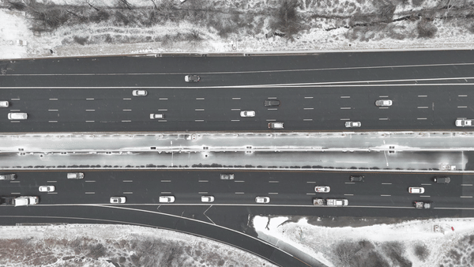
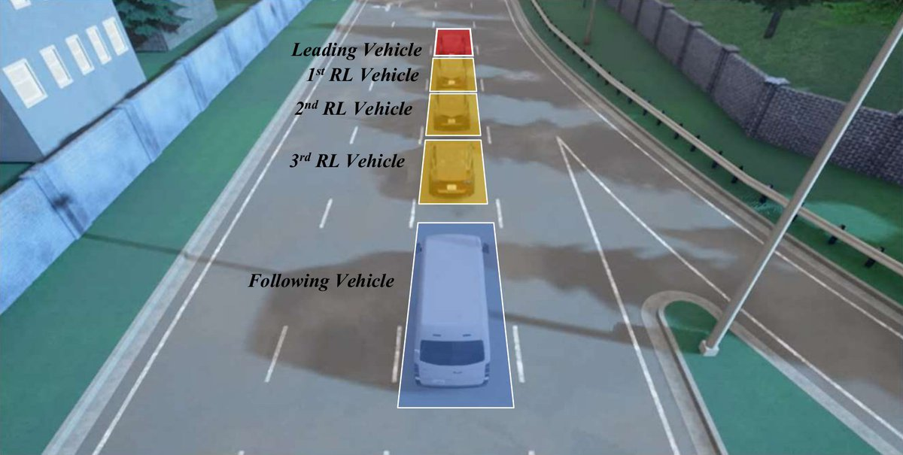
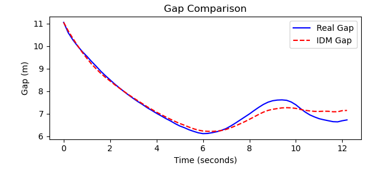
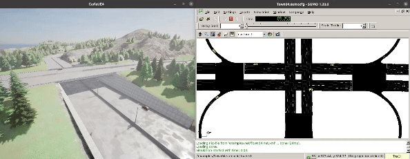

<div align="center">

<h1>HighwayDT</h1>

<p><b>A data-driven digital twin of a highway segment on Interstate 695, built from drone-recorded vehicle trajectories and run as a SUMO–CARLA co-simulation.</b></p>

<p>
  <a href="https://arxiv.org/abs/2607.08137"></a>
  <a href="https://www.python.org/"></a>
  <a href="https://carla.org/"></a>
  <a href="https://eclipse.dev/sumo/"></a>
  <a href="LICENSE"></a>
  
</p>

<p>
  <a href="https://arxiv.org/abs/2607.08137"><b>Paper (arXiv)</b></a> &nbsp;·&nbsp;
  <a href="https://nsf-oac.readthedocs.io/en/latest/"><b>Documentation</b></a> &nbsp;·&nbsp;
  <a href="KNOWN-ISSUES.md"><b>Known issues</b></a>
</p>

</div>

HighwayDT is a data-driven digital twin of a highway segment on Interstate 695 in Baltimore, Maryland, where road tests of new vehicle control policies would be unsafe. The twin is built from vehicle trajectories that a drone recorded on this segment. It reproduces car-following behavior with the recorded trajectories and a calibrated Intelligent Driver Model (IDM), a widely used model of how a driver adjusts speed to the vehicle ahead. HighwayDT runs a SUMO–CARLA co-simulation, which couples the SUMO traffic simulator with the CARLA driving simulator under additional physical constraints such as weather and road friction. It generates many scenarios in parallel and supports closed-loop simulation and predictive analytics for testing control policies. A fidelity test of following distances against real-world measurements shows only a small deviation.

**Status.** Research prototype. This repository contains part of HighwayDT: a sample of the drone trajectories, the IDM calibration notebook and its guideline, the CARLA scripts for weather, road friction and LiDAR recording, and the Sphinx documentation for setting up CARLA, SUMO and their co-simulation. The SUMO network of the Interstate 695 segment and the scenario files used in the paper are not included. **The federated reinforcement learning training, attack and defense code of the paper is not part of this repository.** A static review found several defects in the scripts and the notebook, listed in [KNOWN-ISSUES.md](KNOWN-ISSUES.md).

## What it looks like

<table>
<tr>
<td width="50%"></td>
<td width="50%"></td>
</tr>
<tr>
<td><em>The recorded segment of Interstate 695 on January 15, 2024. The trajectories in <code>Data/</code> come from this footage.</em></td>
<td><em>A HighwayDT scene used in the paper: a leading vehicle (red), three ego vehicles (yellow) and a following vehicle (blue) in one lane. Image from Zhang et al., arXiv:2607.08137.</em></td>
</tr>
<tr>
<td></td>
<td></td>
</tr>
<tr>
<td><em>Gap to the leader of one recorded vehicle and of the calibrated IDM, from <code>Data/Sample.ipynb</code>.</em></td>
<td><em>SUMO–CARLA co-simulation on CARLA's Town04 map with changing weather.</em></td>
</tr>
</table>

## Install

The calibration notebook needs only Python packages. `sko` is installed as `scikit-opt`.

```bash
git clone https://github.com/ZzZTripleZzZ/highwayDT.git && cd highwayDT
python3 -m venv .venv && source .venv/bin/activate
pip install pandas numpy matplotlib scikit-opt jupyter
```

The CARLA scripts and the co-simulation need a CARLA 0.9.x server and SUMO.

- **CARLA.** Download a 0.9.x release from the [CARLA releases page](https://github.com/carla-simulator/carla/releases) and follow the [CARLA documentation](https://carla.readthedocs.io/). Install the Python client that matches the server version, for example `pip install carla==0.9.15`, plus `numpy opencv-python matplotlib` for the scripts in `Code/`.
- **SUMO.** Follow the [SUMO installation guide](https://sumo.dlr.de/docs/Installing/index.html) and set `SUMO_HOME`.
- **Co-simulation.** CARLA ships the SUMO bridge in `Co-Simulation/Sumo/`. The [CARLA–SUMO co-simulation guide](https://carla.readthedocs.io/en/latest/adv_sumo/) explains the setup. The [project documentation](https://nsf-oac.readthedocs.io/en/latest/) gives an Ubuntu walkthrough. Its sources are in `docs/source/`.

## Quick start

Calibrate the IDM on the trajectory sample. The notebook reads the CSV by relative path, so start it from `Data/`.

```bash
cd Data && jupyter notebook Sample.ipynb
```

Start a CARLA server, then run a script from `Code/` against it on `localhost:2000`.

```bash
./CarlaUE4.sh                                   # in the CARLA folder
python Code/LidarData_compar.py --frames 500    # LiDAR top view, written to _out/lidar_output.mp4
python Code/Weather_friction_change.py          # cycles weather presets every 3 s
python Code/Town_07_truck_weather_change.py     # Town07 truck with a chase camera, written to Video/output.mp4
```

The road friction part of the two weather scripts has no effect at the moment, see [KNOWN-ISSUES.md](KNOWN-ISSUES.md). To run CARLA's SUMO bridge on its Town04 example, as in the GIF above:

```bash
cd $CARLA_ROOT/Co-Simulation/Sumo
python run_synchronization.py examples/Town04.sumocfg --sumo-gui
```

## What HighwayDT models

**Trajectory data.** A drone recorded the Interstate 695 segment in Baltimore on January 15, 2024, in snowy conditions. The 50 minutes of 4K video at 30 frames per second were processed into vehicle trajectories. `Data/Snowy_I-695_Sample01.csv` is a 300 s sample with 113 vehicles. [Data/README.md](Data/README.md) lists its columns.

**Car-following model.** HighwayDT uses the IDM, in which follower $n$ with speed $v_n$, gap $s_n$ and approach rate $\Delta v_n$ to its leader accelerates as

$$\frac{dv_n}{dt} = a\left[1-\left(\frac{v_n}{v_0}\right)^{\delta}-\left(\frac{s^{*}(v_n,\Delta v_n)}{s_n}\right)^{2}\right], \qquad s^{*} = s_0 + v_n T + \frac{v_n\,\Delta v_n}{2\sqrt{ab}},$$

where $a$ is the maximum acceleration, $b$ the comfortable deceleration, $v_0$ the desired speed, $s_0$ the minimum gap, $T$ the time gap and $\delta = 4$.

**Calibration.** A genetic algorithm fits $(s_0, T, a, b, v_0)$ by minimizing the root mean square error of the spacing between recorded and simulated trajectories. It runs 200 generations of 100 individuals with a mutation rate of 0.05 and a 0.2 s simulation step. The notebook bounds the parameters to $s_0 \in [1, 5]$ m, $T \in [0.1, 3]$ s, $a \in [0.1, 4]$ m/s², $b \in [0.1, 9]$ m/s² and $v_0 \in [8, 33]$ m/s. The guideline PDF in `Data/` explains the calibration procedure.

**Simulation.** SUMO moves the traffic and CARLA renders the vehicles, sensors and environment. On top of the calibrated car-following behavior, HighwayDT changes the weather and the road friction during a run to model slippery roads.

## How the paper uses HighwayDT

The paper trains connected vehicles with federated reinforcement learning and tests the resulting policy in HighwayDT. The control task is longitudinal control and collision avoidance. In each scenario, three ego vehicles drive in one lane between a leading vehicle and a following vehicle, and the policy sets their acceleration.

- **State.** An eight-dimensional vector: the gap between the leading and the ego vehicle, the gap between the ego and the following vehicle, and the speeds and accelerations of the leading, ego and following vehicles.
- **Action.** A continuous acceleration command in $[-12, 3]$ m/s².
- **Reward.** A reward for every time step without a collision and a large penalty when a collision occurs.

In the paper's setup, 10 vehicles train for 2,000 rounds in their local twin environments, and the global policy is then tested on more than 50,000 physically feasible scenarios generated by HighwayDT. As stated above, this training, attack and defense code is not in this repository.

## Repository layout

```
highwayDT/
├── Code/
│   ├── LidarData_compar.py              # records a top view of a LiDAR point cloud in CARLA
│   ├── Weather_friction_change.py       # cycles CARLA weather presets and friction values
│   └── Town_07_truck_weather_change.py  # truck with a chase camera in Town07 under changing weather
├── Data/
│   ├── Snowy_I-695_Sample01.csv         # drone trajectory sample from Interstate 695
│   ├── Sample.ipynb                     # IDM calibration with a genetic algorithm
│   ├── Guidelines for Calibrating Car-Following Models.pdf
│   └── README.md                        # column description
├── docs/
│   ├── source/                          # Sphinx sources of the Read the Docs site
│   ├── img/                             # images used in this README
│   ├── Makefile
│   └── make.bat
├── .readthedocs.yaml
├── KNOWN-ISSUES.md
└── LICENSE
```

## Citation

HighwayDT is described in the following paper. Please cite it if you use this repository.

```bibtex
@article{zhang2026securing,
  title   = {Securing Autonomous Vehicle Systems via Twin-Aware Federated Reinforcement Learning},
  author  = {Zhang, Zifan and Fang, Minghong and Chen, Dianwei and Liu, Zhuqing and Khanduri, Prashant and Yang, Xianfeng and Das, Anupam and Liu, Yuchen},
  journal = {arXiv preprint arXiv:2607.08137},
  year    = {2026}
}
```

## License

MIT, see [LICENSE](LICENSE).

## Contact

Zifan Zhang, zzhang66@ncsu.edu

## Acknowledgments

The drone data collection and the original SUMO–CARLA co-simulation platform are the work of the M-TRAIL lab at the University of Maryland, led by Xianfeng Terry Yang, with Dianwei Chen, under the NSF Office of Advanced Cyberinfrastructure (OAC) project on a stochastic simulation platform for assessing the safety of autonomous vehicles in winter seasons.
